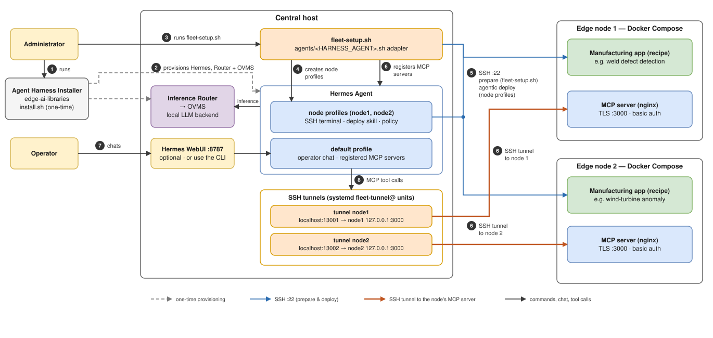
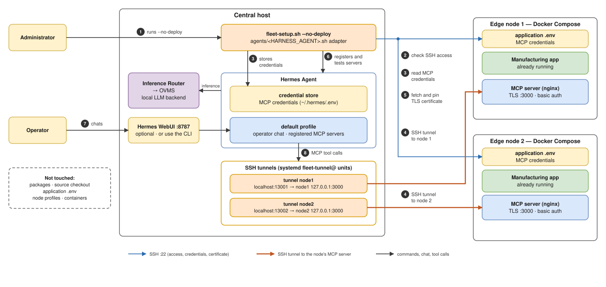

# Configure the Inventory and Deploy

Do the tasks on this page on the central host. Do them in this order:

1. [Prepare the inventory](#prepare-the-inventory)
2. [Validate the inventory](#validate-the-inventory)
3. [Run the installer](#run-the-installer)
4. [Verify the MCP registration](#verify-the-mcp-registration)

To connect an application that you deploy yourself, see [Connect applications that are already running](#connect-applications-that-are-already-running).

**Before you start, make sure that:**

- Hermes uses the local model. See [Install Hermes, Set the Persona, and Bring Up the WebUI](set-up-central-host.md).
- The `SOUL.md` persona is installed on the default profile.
- The edge nodes are ready. See [Prepare the Edge Nodes](prepare-edge-nodes.md).

The installer recreates each node profile as a clone of the default profile. The node profiles inherit its model configuration and persona. The chat history of a node profile is not kept between runs.

## Prepare the inventory

**Caution:** A recipe deployment removes and recreates its managed checkout. Back up local files and manually supplied credentials in the checkout before you deploy again.

1. Open `hosts.yaml`.
2. Replace `node1.example.invalid` and `node2.example.invalid` with the real addresses of your edge nodes. These `.invalid` names are placeholders.
3. Under `defaults`, check the deployment user, the SSH port, and the private-key path. Override a value for a node only when it is different.
4. Give each deployment a stable and unique `name`. The name identifies the Hermes profile and the MCP server.
5. Give each deployment a unique `local_port`.
6. Review the recipe: repository, branch, application directory, skill, prompt, environment updates, and MCP certificate settings.

Do not put passwords, tokens, or other secrets in the inventory. The installer creates missing application credentials. It sends them to the node over SSH. It asks for an SSH password only to install a key.

## Validate the inventory

This command does not connect to nodes. It does not change anything.

1. Print and validate the planned deployments:

   ```bash
   ./fleet-setup.sh --list
   ```

2. Check the node names, recipes, profiles, hosts, local ports, and skills.
3. If a value is wrong, edit the inventory. Run the command again.

To use a different inventory file, add `--hosts`:

```bash
./fleet-setup.sh --hosts /path/to/hosts.yaml --list
```

## Run the installer

Run the installer in an interactive terminal. Use the same user that installed and configured Hermes.



The diagram shows `./fleet-setup.sh` without options. The installer reaches each node over SSH. The agent reaches each MCP server through an SSH tunnel. The node applications are not exposed to the network.

The arrows have these colors:

- Dashed gray: one-time provisioning.
- Blue: SSH preparation and deployment.
- Orange: SSH tunnels to the node MCP servers.
- Black: commands, chat, and tool calls.

| Arrows | Phase | What happens |
| --- | --- | --- |
| 1–2 | Provision (one time) | The administrator installs Hermes, the Inference Router, and OVMS on the central host. See [Install Hermes with a local model](./set-up-central-host.md#install-hermes-with-a-local-model). |
| 3 | Deploy | The administrator runs `fleet-setup.sh`. |
| 4 | Deploy | `fleet-setup.sh` creates one profile for each node. It clones the default profile. Each profile has an SSH terminal for its node, the deployment skill, and an approval policy. |
| 5 | Deploy | `fleet-setup.sh` prepares each node over SSH. It installs packages, gets the application checkout, and generates credentials. The node profile then builds and starts the application and its MCP server. |
| 6 | Connect | For each node, the installer starts a `fleet-tunnel@` systemd unit. The unit opens an SSH tunnel from a local port to the MCP endpoint of the node. The local port is `localhost:13001` for node 1 and `localhost:13002` for node 2. The endpoint is `127.0.0.1:3000` (nginx with TLS). The installer pins the server certificate. It registers the tunnel URL, a credentials reference, and the tool allow-list with the default profile. |
| 7 | Operate | Operators chat with the default profile in the WebUI or the CLI. |
| 8 | Operate | The questions become MCP tool calls. They go through the SSH tunnels to the node applications. |

To run the installer, do these steps:

1. From the `factory-defects-inspector-agent` directory, run:

   ```bash
   ./fleet-setup.sh
   ```

2. Keep the terminal open. Answer the SSH, `sudo`, and approval prompts.
3. Wait for the connection summary.
4. If a step fails, read the error and the stage output. Then run the installer again.

The installer uses `hosts.yaml` by default. It validates the inventory and checks the central host. Then, for each deployment, it can do these tasks:

- Create or use the SSH key. Run `ssh-copy-id` to install the public key on the node. Enter the node password in the terminal. Never enter it in a Hermes chat.
- On apt-based systems, install missing packages. Add the deployment account to the `docker` group. These steps can ask for `sudo`.
- Install the deployment skill. Prepare the application checkout and environment. Run the deployment prompt and the smoke check of the recipe.
- Open a user-level SSH tunnel. Pin the TLS certificate of the MCP server. Register the server and the allowed tools with Hermes. Test the connection.
- Enable user lingering for the central-host user with `loginctl enable-linger`. See [Restore user lingering](../how-to-guides/admin-redeploy-and-handle-credentials.md#restore-user-lingering).

### Installer options

| Option | Purpose |
| --- | --- |
| `--list` | Validate and show the planned deployments. Does not connect to nodes or change anything. |
| `--hosts PATH` | Use a different inventory file. |
| `--node NAME` | Select a node. Can be repeated. |
| `--recipe NAME` | Select a recipe. Can be repeated. |
| `--interactive` | Work through one deployment in an interactive Hermes session. |
| `--no-deploy` | Connect applications that are already running. See [Connect applications that are already running](#connect-applications-that-are-already-running). |
| `--prepare-only` | Prepare the nodes and node profiles, then stop. Cannot be used with `--no-deploy`. |
| `--user NAME` | Set the default SSH user when the inventory has none. |
| `--skip-platform-check` | Skip the hardware check. Use only for CI or validation. Do not use it to bypass production hardware requirements. |

If you give no `--node` or `--recipe`, the installer processes every assignment in the inventory.

Example: deploy one node in an interactive session. The checked-in inventory has one deployment for `node1`:

```bash
./fleet-setup.sh --node node1 --interactive
```

If a node has more than one deployment, add `--recipe` with the recipe identifier.

### Agent adapters

The `HARNESS_AGENT` environment variable selects the agent adapter. The adapter is the file `agents/<name>.sh`. The default and only adapter is `hermes`. The adapter contract is in `agents/hermes.sh`.

Agentic deployment needs an adapter that declares the `deploy` capability. Other adapters can run only `--prepare-only` and `--no-deploy`.

## Verify the MCP registration

1. For each deployment, run `hermes mcp test` with its `name` from the inventory:

   ```bash
   hermes mcp test node1
   hermes mcp test node2
   ```

2. If Hermes is already running, start a new session. Or run `/reload-mcp`.

3. Optional: check the tools in a one-shot chat:

   ```bash
   hermes chat --oneshot -q \
     "Call mcp__node1__describe and mcp__node2__describe and summarize each result."
   ```

The tunnel and the MCP server must be available for the test to pass.

**Caution:** Do not disable certificate verification to fix a TLS error. The installer pins the certificate. If the application runs with a regenerated certificate, run `./fleet-setup.sh --no-deploy`. This command renews the pin and the registration. It does not redeploy the application.

## Connect applications that are already running

Two options let you deploy an application yourself and still use the agent. Choose one:

| Option | Use when | Command |
| --- | --- | --- |
| [Option 1](#option-1-connect-an-application-that-already-runs) | The application already runs on the node. | `--no-deploy` |
| [Option 2](#option-2-deploy-the-application-yourself-then-connect-it) | You want the installer to prepare the node, and you deploy the application. | `--prepare-only`, then `--no-deploy` |

You cannot use `--prepare-only` and `--no-deploy` in the same command.

### Option 1: Connect an application that already runs

#### Before you connect

Do these checks before you run `--no-deploy`:

1. Make sure that the application runs on the node.
2. Find the location of the application:
   - If the application is in the managed checkout `~/fleet-deployments/<deployment name>/checkout`, do nothing. Do not set `app_path`.
   - If the application is in a different location, set `app_path` on its deployment in `hosts.yaml`. Use a path relative to the home directory of the node user, for example `apps/weld`. Do not use an absolute path, `~`, `.`, or `..`. The installer rejects them.

   **Note:** A deployment that has `app_path` is connect-only. Deploy and `--prepare-only` runs refuse it. A deployment in the managed checkout can use all the installer modes.

3. Make sure that the `.env` file of the application has `MCP_USERNAME` and `MCP_PASSWORD` (or the token of the recipe). The installer reads them from this file.
4. If the `.env` file has no credentials, the installer uses the credentials that it stored on the central host. In a terminal, it can ask for them with hidden input. Otherwise it stops and names the missing credential.

**Caution:** Never put credentials in `hosts.yaml`, on the command line, or in a chat.

#### Run the connect command

1. From the `factory-defects-inspector-agent` directory, run:

   ```bash
   ./fleet-setup.sh --node node1 --no-deploy
   ```



The command does these steps:

| Step | Action | Where |
| --- | --- | --- |
| 1 | Checks SSH access. Installs your public key if necessary. | Central host to node, over SSH |
| 2 | Reads the MCP credentials. | The `.env` file of the application on the node |
| 3 | Starts the SSH tunnel. | A `fleet-tunnel@` systemd unit on the central host |
| 4 | Fetches and pins the MCP TLS certificate. | The nginx container of the node, over SSH |
| 5 | Registers the MCP server and its allowed tools. | The default Hermes profile |
| 6 | Tests the connection. | `hermes mcp test` |

The command does not touch packages, source code, the application `.env`, node profiles, or running containers. It does not need `sudo`. It restarts the tunnel and rewrites the registration, so it is not read-only.

### Option 2: Deploy the application yourself, then connect it

1. On the central host, prepare the node:

   ```bash
   ./fleet-setup.sh --node node1 --prepare-only
   ```

   This command installs missing packages. It adds the deployment user to the `docker` group and can ask for `sudo`. It puts the recipe source in `~/fleet-deployments/<deployment name>/checkout`. It generates missing credentials in the `.env` file of the application. It creates the node profile. Then it stops.

2. On the node, connect as the deployment user. Go to the application directory:

   ```bash
   ssh <deployment user>@<node address>
   cd ~/fleet-deployments/<deployment name>/checkout/<app_dir>
   ```

3. Deploy the application. Follow the user guide of the application.

4. Make sure that the application runs. On the central host, do the steps in [Run the connect command](#run-the-connect-command).

### Change the credentials later

1. Change the credentials in the `.env` file of the application.
2. Redeploy the application.
3. Run `--no-deploy` again.
