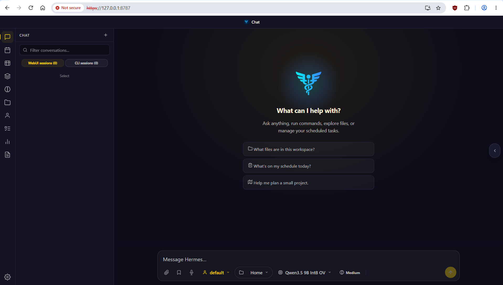

<!--hide_directive
```{eval-rst}
.. meta::
   :description: Install Hermes with a local model, set the Factory Defects Inspector Agent
      persona, and bring up the Hermes WebUI on the central host.
   :keywords: Hermes, OpenVINO Model Server, OVMS, Inference Router, persona, WebUI,
      central host
```
hide_directive-->

# Install Hermes, Set the Persona, and Bring Up the WebUI

Do the tasks on this page on the **central host**. Use the same user account that will run the fleet setup. Do not do them on the edge nodes.

The sections are in order:

1. [Install Hermes with a Local Model](#install-hermes-with-a-local-model)
2. [Verify the Local Model](#verify-the-local-model)
3. [Set the Factory Defects Inspector Agent Persona](#set-the-factory-defects-inspector-agent-persona)
4. [Bring Up the Hermes WebUI](#bring-up-the-hermes-webui)

## Install Hermes with a Local Model

The [Agent Harness Installer](https://github.com/open-edge-platform/edge-ai-libraries/tree/release-2026.3.0/frameworks/agent-harness-install) installs Hermes. It also installs a local OpenVINO™ Model Server (OVMS) and an Inference Router.

**Before you start:**

- Read the [get-started prerequisites](https://github.com/open-edge-platform/edge-ai-libraries/blob/release-2026.3.0/frameworks/agent-harness-install/docs/user-guide/get-started.md) of the installer.
- For a GPU install, make sure that the Intel GPU driver and compute runtime are installed.
- Make sure that the host has enough memory and disk space for the model and the container images.
- Review the license of the [OpenVINO/Qwen3.5-9B-int8-ov](https://huggingface.co/OpenVINO/Qwen3.5-9B-int8-ov) model prior to deployment.
- For a reproducible deployment, use the reviewed repository revision of your site.
- If your network needs a proxy, set it in the installer environment before you run the installer.

> [!CAUTION]
> The installer can change the Docker daemon proxy and restart Docker. Run it on a host where
> a Docker restart does not interrupt other workloads.

1. Clone the installer repository:

   ```bash
   git clone https://github.com/open-edge-platform/edge-ai-libraries.git -b release-2026.3.0
   cd edge-ai-libraries/frameworks/agent-harness-install
   ```

2. Install Hermes with the OVMS image and the model:

   > [!TIP]
   > Go with the default values during the `./install.sh` execution.

   ```bash
   export no_proxy="${no_proxy:-${NO_PROXY:-localhost,127.0.0.1,::1}}"
   HARNESS_OVMS_IMAGE=openvino/model_server:2026.4.1-gpu ./install.sh --harness hermes --model OpenVINO/Qwen3.5-9B-int8-ov
   ```

3. Read the install output. Make sure that the model registration is successful. A completed
   download is not sufficient.

OVMS serves the model through the Inference Router service. Hermes uses this local model for
all inference.

The installer prepares the host, starts OVMS and the Inference Router, downloads the model,
and installs Hermes. The `OpenVINO/*` models are pre-converted. OVMS serves the model only if
the downloaded repository has the `graph.pbtxt` file.

If the model needs access credentials, supply them through environment variables. Do not put
them in the command or the inventory.

## Verify the Local Model

The installer does not configure or test Hermes — follow these steps to configure and test it:

1. Find the `hermes config set` commands in the installer output. They point Hermes to the
   Inference Router. Do not use the OVMS endpoint directly.

2. Run the commands. For example:

   ```bash
   hermes config set model.provider custom
   hermes config set model.base_url http://127.0.0.1:8010/v1
   hermes config set model.default Qwen3.5-9B-int8-ov
   ```

   Use the values from your installer output. The base URL is the Inference Router and ends in `/v1`.
   `model.default` is the served model name.

3. If the installer reports that the router needs an API key, set the key as the installer
   output says. Do not put the key in a file that you commit.

4. Start a test chat:

   ```bash
   hermes
   ```

5. Ask a simple question. Make sure that Hermes gives a response.

If the model does not respond, do not continue. Fix the problem first:

- Run `./install.sh status` in the installer checkout. It shows the health of OVMS, the router,
  and the agent.
- Run `./install.sh models list`. It shows if the model is served.

When the model responds, return to the `factory-defects-inspector-agent` directory of this
repository.

> [!NOTE]
> The fleet installer clones each node profile from the default profile. The node profiles
> inherit the model configuration. If you change the default model, run `fleet-setup.sh`
> again to recreate the node profiles. After deployment, test the Model Context Protocol
> (MCP) tool calls with this model. Tool-calling behavior depends on the model.

To use a hosted provider, run `hermes setup model`. Get approval for the provider and model
from your administrator first. A hosted provider can receive prompts and tool results. Use it
only with data that the provider is approved for.

## Set the Factory Defects Inspector Agent Persona

`SOUL.md` is the persona template for this agent. It defines these items:

- The purpose of the assistant.
- Evidence-based reporting.
- The administrator and operator workflows.
- The confirmation boundaries for operational changes.

`SOUL.md` has no node addresses, credentials, or model selections.

**Install the persona before you run the fleet installer.** The installer clones each node
profile from the default profile. The clone copies `SOUL.md` at that time. A persona that you
install later reaches the node profiles only when you run the installer again.

1. Read `SOUL.md`.

2. From the `factory-defects-inspector-agent` directory, run:

   ```bash
   ./hermes-webui.sh start
   ```

   The command installs `SOUL.md` in the Hermes home and then starts the WebUI. The default
   Hermes home is `~/.hermes`; if `HERMES_HOME` is set, it uses that directory. The file has
   owner-only permissions. See [Bring Up the Hermes WebUI](#bring-up-the-hermes-webui)
   for the WebUI details.

   The command never overwrites an existing persona. To replace it with the template, delete
   `SOUL.md` from the Hermes home and run the command again.

3. Start a new chat on the default profile, in the CLI or the WebUI.

4. Ask the agent to explain its role. Ask how it handles a request to stop a pipeline.

5. Make sure that the agent identifies the target and asks for approval. It must not make a
   change.

> [!NOTE]
> The persona is behavioral guidance. It is not access control. The fleet installer never
> installs or overwrites the persona of the default profile. A change to the template does not
> change an existing Hermes installation.

## Bring Up the Hermes WebUI

The Hermes WebUI is community software. It gives browser-based chat for the local Hermes installation.
It is not a part of the fleet deployment. Using it is optional; you can use the Hermes CLI instead.
The `start` command that installs the persona also starts the WebUI. Run
`./hermes-webui.sh stop` to stop it.

> [!WARNING]
> The WebUI gives terminal and file access with the permissions of the central Hermes user.
> The administrator and operator roles in this guide are not access-control roles. Give access
> only to trusted operators. A profile selection is not a security boundary.

**Before you start, make sure that:**

- `git`, Python 3, `curl`, and `openssl` are installed.
- The host can reach the WebUI Git repository.
- `~/.hermes/config.yaml` exists. If `HERMES_HOME` is set, check that directory.
- Local port `8787` is free.

**Start the WebUI:**

1. Run the command as the user who configured Hermes. Use the `factory-defects-inspector-agent` directory:

   ```bash
   ./hermes-webui.sh start
   ```

2. On the first run, the script clones the WebUI to `~/hermes-webui`. It checks out the pinned
   release `v0.52.492`.

3. On the first run only, the script asks for a password and asks you to repeat it. The password
   must have at least 12 characters. It must not contain quotes. If the script runs without an
   interactive terminal (for example, from automation), it does not prompt. It generates a
   random password instead. The script saves the password in `~/hermes-webui/.env`. Later runs of
   `start` reuse it and do not ask again. To read it, run
   `grep HERMES_WEBUI_PASSWORD ~/hermes-webui/.env`. To change it, edit that line in the file, then
   run `./hermes-webui.sh stop` and `./hermes-webui.sh start`. A running WebUI keeps the old
   password until it is stopped.

4. The script creates a self-signed certificate in `~/.hermes/webui-tls` (`cert.pem` and `key.pem`,
   mode `600`, valid 365 days) if there is none or it expires within 30 days. It adds the
   certificate to `~/hermes-webui/.env`, so the WebUI serves HTTPS only. The certificate names
   `localhost`, the host name, and the IPv4 addresses of the host at creation time. To create a
   new one, for example after an address change, delete the `webui-tls` directory and run
   `start` again.

   Before it starts the WebUI, the script checks that the certificate and the key match. If they
   do not, it stops with an error instead of starting. The server would otherwise fall back to
   plain HTTP.

5. Wait for the message that the WebUI is up. The script stores the settings in `~/hermes-webui/.env`
   with mode `600`. It starts the daemon and checks the `/health` endpoint over HTTPS. If the
   server cannot load the certificate, it would fall back to plain HTTP. The script then stops it
   and reports an error.

6. Open <https://127.0.0.1:8787/>. The browser warns about the self-signed certificate. Accept it
   once, or import `~/.hermes/webui-tls/cert.pem` as a trusted certificate on the client.

7. After you sign in, make sure that the chat view shows the `default` profile and the local
   model that you installed, for example `Qwen3.5 9B Int8 OV`.

   

To choose the bind address, add `--host <ADDR>` to `start`.

### Remote Access

By default, the WebUI listens on `127.0.0.1` only. Choose one of these options to reach it from
another system. The WebUI password in `~/hermes-webui/.env` is required in both options.

#### Option 1: Direct Access on a Trusted Network

> [!CAUTION]
> The connection is encrypted, but the certificate is self-signed. Clients must trust it, or
> users learn to click through browser warnings. Use a firewall to limit access to authorized
> clients, and expose the service only on a trusted network.

1. On the central Hermes host, set `--host` to the IPv4 address of the interface that your
   operators use:

   ```bash
   ./hermes-webui.sh --host <central-host-ip> start
   ```

   To listen on all IPv4 interfaces, use `0.0.0.0`. Prefer a specific address, because `0.0.0.0`
   also exposes the WebUI on other interfaces, such as Docker bridges.

   ```bash
   ./hermes-webui.sh --host 0.0.0.0 start
   ```

   A running WebUI restarts with the new address. The script saves the bind address for the
   next starts.

2. On the remote system, open `https://<central-host-ip>:8787/`. `0.0.0.0` is not a browser address.

To return to loopback, run this command on the central Hermes host:

```bash
./hermes-webui.sh --host 127.0.0.1 start
```

#### Option 2: Loopback with SSH Forwarding

Use this option when the network is not trusted. The WebUI stays on `127.0.0.1`.

1. On the remote system (not the central Hermes host), forward the port:

   ```bash
   ssh -N -L 8787:127.0.0.1:8787 <user>@<central-host-ip>
   ```

   `<user>` is the user that runs the WebUI.

2. On the remote system, open `https://127.0.0.1:8787/`.

### Manage the WebUI

| Command | Action |
| --- | --- |
| `./hermes-webui.sh start` | Install or update to the pinned release, install the persona and the TLS certificate if missing, then start. |
| `./hermes-webui.sh stop` | Stop the daemon. |

For status and logs, run `~/hermes-webui/ctl.sh status` or `~/hermes-webui/ctl.sh logs`.

To override the defaults, set `HERMES_WEBUI_DIR`, `HERMES_WEBUI_VERSION`, or `HERMES_WEBUI_PORT`.
Use a reviewed stable release tag. If you change the port, also change the browser URL and the
SSH forwarding ports.
