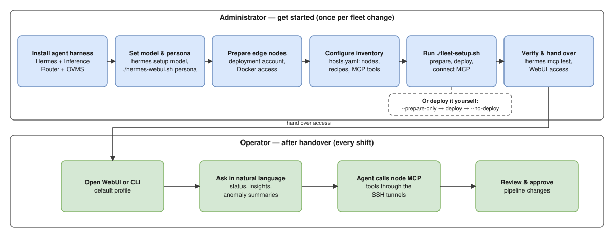
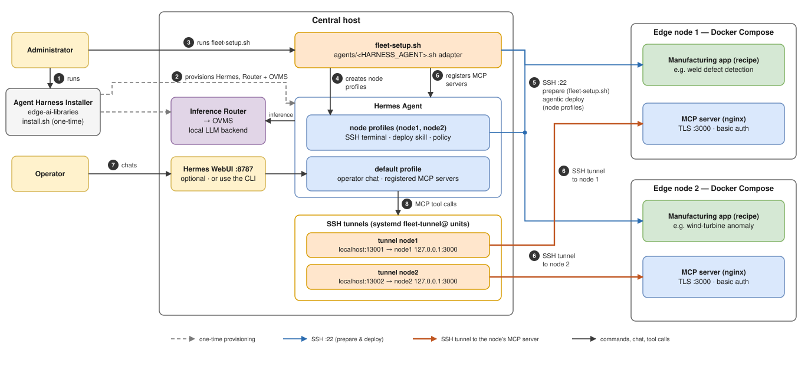
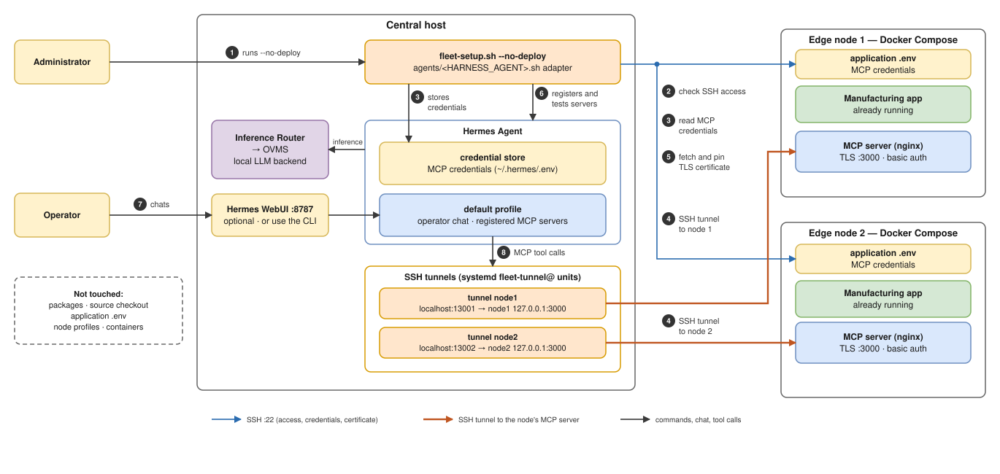

# How It Works

This page shows how the central host, the edge nodes, and the MCP connections fit together. For the steps, see [Get Started](./get-started.md).

## Roles

The administrator sets up the system once for each fleet change. Operators then use chat. They do not use the installer.

**Administrator tasks:**

1. Install the agent harness. It has Hermes, a local Inference Router, and OVMS.
2. Set the model and the `SOUL.md` persona.
3. Prepare the deployment account and Docker access on each node.
4. Describe the nodes and recipes in `hosts.yaml`.
5. Run `./fleet-setup.sh`.
6. Run `hermes mcp test` for each node.
7. Give the WebUI password or CLI access to the operators.

To deploy an application without the agent, run `--prepare-only`. Deploy the application on the node. Then run `--no-deploy`. The dashed box in the diagram shows this path.

**Operator tasks:**

1. Open the WebUI or the CLI on the default profile.
2. Ask questions in natural language.

The agent answers through the registered MCP tools. It asks for confirmation before it changes a pipeline.

## Full run: prepare, deploy, and connect

One central host runs the agent and the LLM backend. Each edge node runs a manufacturing application and its MCP server.

The installer reaches each node over SSH. The agent reaches each MCP server through an SSH tunnel. The node applications are not exposed to the network.

The diagram shows `./fleet-setup.sh` without options. The arrows have these colors:

- Dashed gray: one-time provisioning.
- Blue: SSH preparation and deployment.
- Orange: SSH tunnels to the node MCP servers.
- Black: commands, chat, and tool calls.

| Arrows | Phase | What happens |
| --- | --- | --- |
| 1–2 | Provision (one time) | The administrator runs the [Agent Harness Installer](https://github.com/open-edge-platform/edge-ai-libraries/tree/main/frameworks/agent-harness-install). It sets up Hermes, the Inference Router, and OVMS on the central host. It does nothing in later deployments or chats. |
| 3 | Deploy | The administrator runs `fleet-setup.sh`. |
| 4 | Deploy | `fleet-setup.sh` creates one profile for each node. It clones the default profile. Each profile has an SSH terminal for its node, the deployment skill, and an approval policy. |
| 5 | Deploy | `fleet-setup.sh` prepares each node over SSH. It installs packages, gets the application checkout, and generates credentials. The node profile then builds and starts the application and its MCP server. |
| 6 | Connect | For each node, the installer starts a `fleet-tunnel@` systemd unit. The unit opens an SSH tunnel from a local port to the MCP endpoint of the node. The local port is `localhost:13001` for node 1 and `localhost:13002` for node 2. The endpoint is `127.0.0.1:3000` (nginx with TLS). The installer pins the server certificate. It registers the tunnel URL, a credentials reference, and the tool allow-list with the default profile. |
| 7 | Operate | Operators chat with the default profile in the WebUI or the CLI. |
| 8 | Operate | The questions become MCP tool calls. They go through the SSH tunnels to the node applications. |

Inference uses the local LLM backend of the central host. The model is `OpenVINO/Qwen3.5-9B-int8-ov`. OVMS serves it through the Inference Router.

## Connect applications that are already running

Use `--no-deploy` when the application already runs on the node. The installer connects the MCP server only. It does not prepare or deploy anything.

The arrows have the same colors as in the full run.

1. **Run:** The administrator runs `./fleet-setup.sh --no-deploy`.
2. **Check SSH access:** The installer connects to each node. It installs the public key if the node does not have it.
3. **Read the credentials:** The installer reads the MCP credentials from the `.env` file of the application on the node. It stores them in the credential store of the agent.
4. **Start the tunnels:** The installer starts one `fleet-tunnel@` unit for each node.
5. **Pin the certificate:** The installer fetches the TLS certificate of the MCP server and pins it.
6. **Register and test:** The installer registers each MCP server with the default profile. It tests the connection.
7. **Operate:** Operators chat with the default profile. The questions become MCP tool calls through the tunnels.

If the `.env` file has no credentials, the installer uses the credentials that it already stored. In a terminal, it can ask for them.

The installer does not do these actions:

- Install packages.
- Copy source code.
- Change the `.env` file.
- Create node profiles.
- Touch the running containers.

The installer restarts the tunnels and replaces the registration. This command is not read-only.

To deploy an application yourself, see [Connect applications that are already running](./get-started/deploy-the-fleet.md#connect-applications-that-are-already-running).
