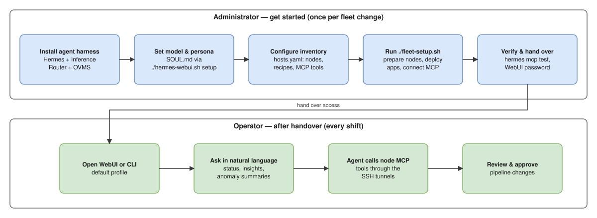
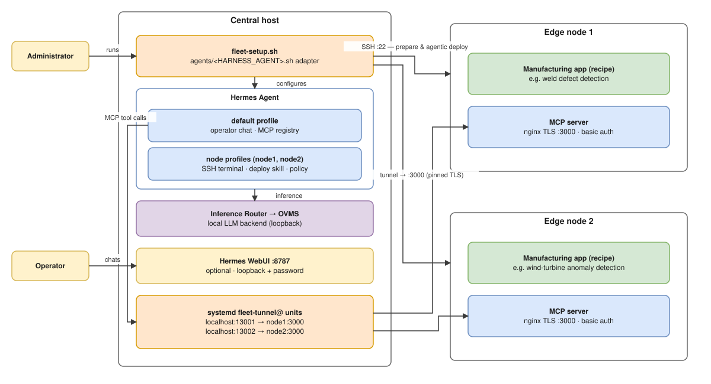

# How It Works

This page gives a high-level view of the Factory Defects Inspector Agent: who does what, and how the central host, the edge nodes, and the MCP connections fit together. For step-by-step instructions, start with [Get Started](./get-started.md).

## Administrator and operator flows

The administrator sets the system up once per fleet change; operators then use it through chat without touching the installer.

- **Administrator:** installs the agent harness (Hermes with a local Inference Router → OVMS backend), sets the model and the `SOUL.md` persona, prepares each edge node's deployment account and Docker access, describes nodes and recipes in `hosts.yaml`, and runs `./fleet-setup.sh`. The installer prepares the nodes, deploys the applications with their MCP servers, and registers each server with the central agent. After `hermes mcp test` passes, the administrator hands the WebUI password (or CLI access) to operators.
- **Operator:** opens the WebUI or CLI on the default profile and asks questions in natural language. The agent answers through the registered MCP tools and asks for confirmation before any pipeline change.

## Deployment and MCP registration

One central host runs the agent and its LLM backend; each edge node runs a manufacturing application with its own MCP server. The node applications are not exposed to the network directly — the installer reaches each node over SSH, and the agent reaches each MCP server through an SSH tunnel.

The numbered arrows show the order: 1–2 provision, 3–5 deploy, 6 connect, 7–8 operate. Arrows are color-coded: dashed gray for one-time provisioning, blue for SSH preparation and deployment, orange for the SSH tunnels to the node MCP servers, and black for commands, chat, and tool calls.

- **Provision (steps 1–2, one-time):** the administrator runs the [Agent Harness Installer](https://github.com/open-edge-platform/edge-ai-libraries/tree/main/frameworks/agent-harness-install), which sets up the central host — Hermes, the Inference Router, and OVMS — as described in [Install Hermes, Set the Persona, and Bring Up the WebUI](./get-started/install-hermes.md). The installer only provisions; it takes no part in later deployments or chats.
- **Deploy (steps 3–5):** the administrator runs `fleet-setup.sh` (step 3), which creates one agent profile per node (step 4), cloned from the default profile, with an SSH terminal pointed at that node, the deployment skill, and an approval policy. Over SSH (step 5), `fleet-setup.sh` prepares each node (packages, application checkout, generated credentials), and the node profiles then run the agentic deployment that builds and starts the application and its MCP server.
- **Connect (step 6):** for each node, the installer starts a persistent `fleet-tunnel@` systemd unit that opens an SSH tunnel from a local port (for example `localhost:13001` for node 1 and `localhost:13002` for node 2) to the node's loopback MCP endpoint (`127.0.0.1:3000`, nginx with TLS). It then pins the server certificate and registers the tunneled URL, a credentials reference, and the tool allow-list with the default profile.
- **Operate (steps 7–8):** operators chat with the default profile through the WebUI or the CLI (step 7). Their questions become MCP tool calls that travel through the SSH tunnels to the node applications (step 8). Inference uses the central host's LLM backend; while the Hermes → Inference Router → OVMS integration is being validated, the get-started guide documents a hosted provider as the temporary model choice.
