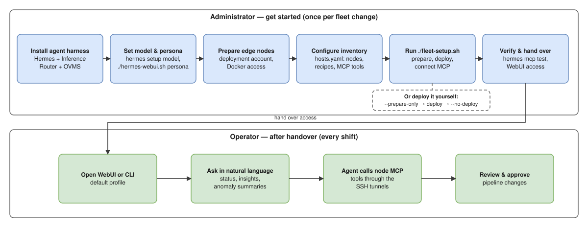

```{eval-rst}
.. meta::
   :description: A Hermes agent that investigates defects and anomalies reported by
      manufacturing applications on remote edge nodes.
```

# Factory Defects Inspector Agent

The Factory Defects Inspector Agent is a [Hermes Agent](https://github.com/NousResearch/hermes-agent) on a central host. It helps people investigate defects and anomalies that manufacturing applications report on remote edge nodes. Examples are weld defect detection and wind-turbine anomaly detection.

**Warning:** The agent supports human decisions. It is not a safety interlock. It does not make final pass/fail decisions.

## Who uses this guide

| Role | Task | Start here |
| --- | --- | --- |
| Administrator | Prepare the central host and edge nodes, then run the installer. | [Get Started](./get-started.md) |
| Operator | Ask Hermes about the registered nodes in natural language. | [Use Hermes as an Operator](./how-to-guides/use-hermes-as-operator.md) |



## What the installer does

The installer is the `fleet-setup.sh` script. For each deployment in the inventory, it does these tasks:

1. Creates a Hermes profile that runs commands on the node over SSH.
2. Prepares the node. Deploys the manufacturing application and its MCP server.
3. Opens an SSH tunnel to the MCP server of the node.
4. Pins the TLS certificate of the MCP server.
5. Registers the MCP server with Hermes.

After setup, the operator starts a new Hermes session. Example request:

> Describe node1 and node2, then summarize their status.

The inventory defines the available nodes, skills, prompts, and MCP tools.

<!--hide_directive
:::{toctree}
:hidden:

get-started.md
how-to-guides.md
release-notes.md

:::
hide_directive-->
