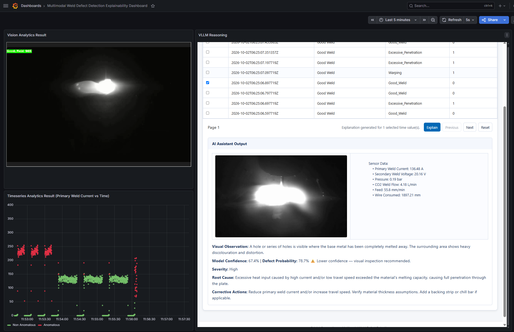

# Deploy the vLLM Service for Defect Explanation

This section shows how to deploy the multimodal sample application with the vLLM service
enabled using the Makefile targets.

## Minimum System Requirements

In addition to the [minimum requirements](../get-started/system-requirements.md#minimum-requirements) and [software requirements](../get-started/system-requirements.md#software-requirements) of the sample application, the vLLM service requires the following:

| Component    | Minimum Requirement                                 |
|--------------|-----------------------------------------------------|
| **Hardware** | Intel® Core™ Ultra Series 3 processor or newer only |
| **RAM**      | Minimum 32 GB                                       |
| **Storage**  | Minimum 256 GB (512 GB recommended)                 |

### Validated Platforms

| Product / Family                                                            | Validated inference device |
|-----------------------------------------------------------------------------|----------------------------|
| Intel® Core™ Ultra Processors Series 3 (Intel Core Ultra 7 356H, 16 Cores, 32GB) | iGPU                       |


## Prerequisites

1. Ensure the `.env` file is configured with valid values for:

   > [!NOTE]
   >
   > - If you are trying to deploy it on Ubuntu 26.04, update the `DLSTREAMER_PIPELINE_SERVER_IMAGE` value in .env
   >   to `intel/dlstreamer-pipeline-server:2026.3.0-ubuntu26-rc1` before deployment.

   - `HOST_IP`
   - `INFLUXDB_USERNAME`, `INFLUXDB_PASSWORD`
   - `VISUALIZER_GRAFANA_USER`, `VISUALIZER_GRAFANA_PASSWORD`
   - `MTX_WEBRTCICESERVERS2_0_USERNAME`, `MTX_WEBRTCICESERVERS2_0_PASSWORD`
   - `S3_STORAGE_USERNAME`, `S3_STORAGE_PASSWORD`
   - `SEAWEEDFS_WEB_AUTH_USER`, `SEAWEEDFS_WEB_AUTH_PASSWORD`

2. Review the [Unsloth Qwen3.5-2B license](https://huggingface.co/unsloth/Qwen3.5-2B/blob/main/LICENSE) prior to deployment.

   > [!NOTE]
   > The [Low-Rank Adaptation (LoRA) adapter](https://huggingface.co/Intel/qwen3.5-2b-vlm-weld-explainability-lora) was specifically trained on a subset of the [Intel Robotic Welding Multimodal Dataset](https://huggingface.co/datasets/IntelLabs/Intel_Robotic_Welding_Multimodal_Dataset) and may not generalize to generic weld datasets.

## Deploy the vLLM Service

> [!NOTE]
> vLLM preallocates GPU-addressable memory up to the limit specified by
> `VLLM_GPU_MEMORY_UTILIZATION` (VRAM on discrete GPU; shared system memory on integrated GPU).
> Since the optimal value varies between platforms, update `VLLM_GPU_MEMORY_UTILIZATION` in
> the `.env` file to match your target hardware.

1. Run the Makefile target:

   ```bash
   cd industrial-edge-insights-multimodal
   make up_vllm
   ```

   > [!NOTE]
   > On the first run, `make up_vllm` automatically downloads the `Unsloth Qwen3.5-2B` model and
   > the fine-tuned LoRA adapter through the model-download microservice into
   > `configs/vllm/huggingface/Qwen3.5-2B` and
   > `configs/vllm/models/qwen3.5-2b-vlm-weld-explainability-lora`. To re-download the models,
  > run `make download_model`.

2. (Optional) To build from source instead of deploying the pre-built artifacts, run the
   following for a fresh build before deployment:

   ```bash
   cd industrial-edge-insights-multimodal
   make build
   make up_vllm
   ```

## Verify the Deployment

1. Check the overall stack health:

   > [!NOTE]
   > The command `make status` may show errors in containers like `ia-grafana` if
   > you have not logged in to the Grafana dashboard for the first time, or if your session has
   > timed out. Log in to the Grafana dashboard, and if the dashboard works correctly, ignore
   > `user token not found` and other minor errors in the Grafana logs.

   ```bash
   cd industrial-edge-insights-multimodal
   make status
   ```

2. Confirm that the vLLM container is running:

   ```bash
   docker ps --filter "name=vllm-server"
   ```

3. Inspect vLLM logs:

   ```bash
   docker logs -f vllm-server
   ```

4. Check the output in Grafana dashboard:
   - Use the link `https://127.0.0.1:3000` to open the Grafana dashboard in a browser, preferably
     the Chrome browser.
   - Log in to the Grafana dashboard using the `VISUALIZER_GRAFANA_USER` and `VISUALIZER_GRAFANA_PASSWORD`
     values from the `.env` file:

     

   - After logging in, click **Dashboards**:
     

   - Select **Multimodal Weld Defect Detection Explainability Dashboard**:
     

   - The following appears:

     


## Stop the Deployment

To bring down the full stack:

```bash
cd industrial-edge-insights-multimodal
make down
```

## Troubleshooting

- `vllm-server` startup delay after deployment
  The `vllm-server` service can take about 10 minutes to fully come up after `make up_vllm`.
  This is expected as the model initializes and loads into memory.

- `Error: configs/vllm/models directory does not exist.`
  Run `make download_model` to download the model and adapter into the expected directories.

- `Error: configs/vllm/models directory is empty.`
  Run `make download_model` before running `make up_vllm`.

- `ERROR: model-download-vllm service did not become ready in time` or a failed download job
  Inspect the service logs with `docker logs vllm-model-download`. If you are behind a proxy,
  ensure `http_proxy`/`https_proxy` are set in your environment before running
  `make download_model`.

- `HOST_IP is not set` or `HOST_IP is not a valid IPv4 address format.`
  Update `HOST_IP` in `.env` with a valid IPv4 address.

- Username and password validation failures from `check_env_variables`
  Update `.env` values so they match the Makefile validation rules.
